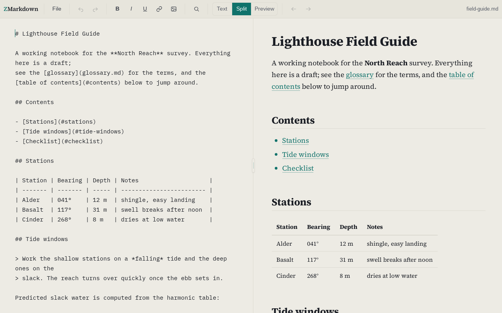
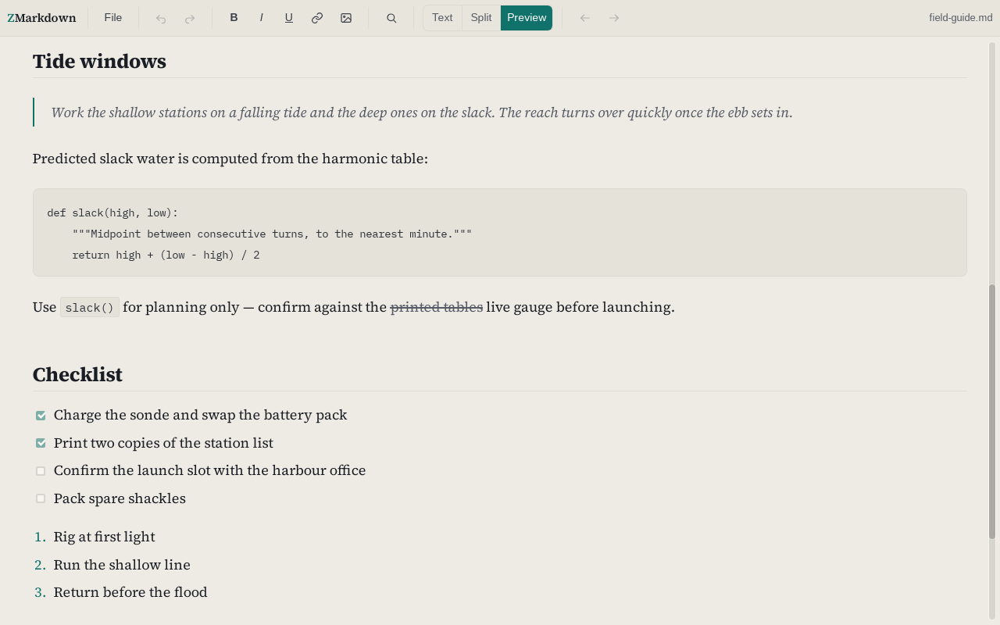
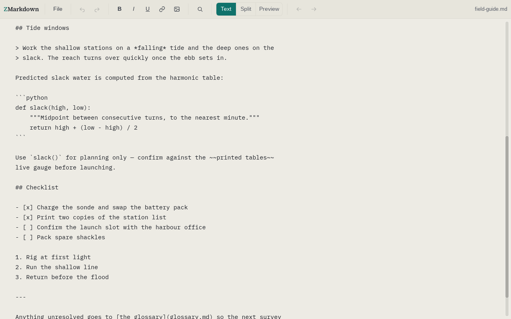
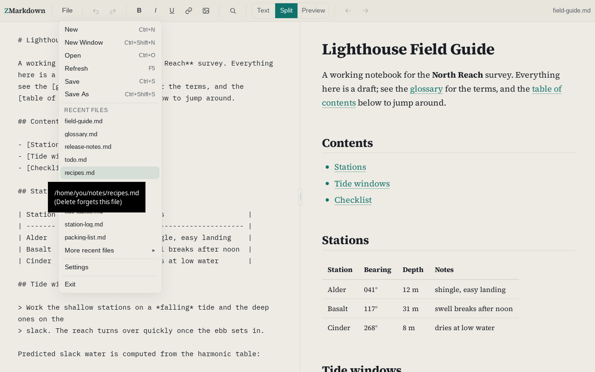

# ZMarkdown

A small, fast desktop markdown editor and viewer. One window, three ways to look at a
document: the raw text, the rendered result, or both side by side with a divider you can
drag. You edit in the raw pane; the rendered pane updates live as you type and is styled to
be genuinely pleasant to read, not plain browser HTML.

Written in Nim, it compiles to a single native executable and uses the system webview
(WebKitGTK on Linux, Edge WebView2 on Windows) for the display.

## Screenshots

Split view: the raw markdown on the left, the live rendered result on the right, with a
divider you can drag all the way to either edge.



Preview only: the rendered reading view.



Text only: a plain markdown editor.



The File menu, with the files you opened most recently listed by name and their full path
on hover.



## Get a prebuilt binary

You do not need to build anything. Prebuilt binaries are published on the project's GitHub
Releases page, built by CI and attached to each tagged release. They are not stored in the
repository; the repository holds source only.

- Linux: download the `zmarkdown-<version>-linux-x86_64.tar.gz`, extract it, and run
  `./zmarkdown`. The archive includes an `install.sh` that copies the binary, the desktop
  entry, and the icons into `~/.local` so the app shows up in your menu.
- Windows 11: download the `zmarkdown-<version>-windows-x86_64.zip`, extract it, and run
  `zmarkdown.exe`. No install step is needed; the Edge WebView2 runtime ships with
  Windows 11.

## Supported platforms

- Kubuntu 24.04 (KDE Plasma) on X11 and on Wayland
- Kali Linux (XFCE)
- Windows 11

Other platforms may work but are not supported.

## Runtime requirements (Linux)

The Linux binary links the system GTK3 and WebKitGTK 4.1 libraries, which the desktops
above already ship. It also needs a native dialog helper for open/save and confirmation
prompts: KDE provides `kdialog`; on other desktops install `zenity` (`make deps` installs
it). The regex library the markdown renderer uses (PCRE) is compiled into the binary, so
nothing else is needed at runtime. On Windows there is no extra runtime dependency.

## Build from source

Everything goes through the `Makefile`. Run `make` on its own to see every target.

```
make deps    # install the toolchain and libraries (uses sudo for system packages on Linux)
make run     # build and launch the app
make test    # run the unit tests and the headless end-to-end smoke test
             # (the smoke test boots the real app on a virtual display, so it
             #  never opens a window on your desktop)
make build   # just build the release binary into build/
make install # install into ~/.local: binary on your PATH, plus menu entry and icons (Linux)
make dist    # build and package the Linux tarball
```

`make install` puts the binary in `~/.local/bin` (make sure that's on your `PATH`) and adds
the desktop entry and icons so it appears in your application menu. Override the location
with `make install PREFIX=/usr/local`, and `make uninstall` removes it again.

`make deps` prints exactly what it is about to do before it does it. On Linux it first
checks which of these system packages are already installed and only uses `sudo apt-get`
for the ones that are missing, showing that list and the exact root commands before asking
for your password. If they are all already present, it does not ask for sudo at all.

| Package | Why |
| --- | --- |
| `build-essential` | C/C++ toolchain (Nim compiles through a C++ backend) |
| `pkg-config` | finds the GTK and WebKit build and link flags |
| `libgtk-3-dev` | GTK 3, the toolkit the Linux webview is built on |
| `libwebkit2gtk-4.1-dev` | WebKitGTK 4.1, renders the markdown preview |
| `zenity` | native file dialog fallback (KDE already ships kdialog) |
| `xvfb` | virtual display, used only by `make test` |
| `ca-certificates`, `curl` | fetch the Nim toolchain over HTTPS |

It then installs the Nim toolchain per-user via choosenim if it is missing (no sudo) and
fetches the pinned Nim dependencies (`markdown`, `tinyfiledialogs`) into `~/.nimble`. On
Windows, run the dependency bootstrap directly (per-user, no administrator rights needed;
the Edge WebView2 runtime is already present on Windows 11):

```
powershell -ExecutionPolicy Bypass -File scripts\deps-windows.ps1
```

then build from Git Bash (the MinGW compiler Nim uses must be on `PATH`; the first
command compiles the bundled regex library — see "Bundled PCRE" below):

```
bash scripts/build-pcre.sh
nim cpp -d:release --hints:off -o:build/zmarkdown.exe src/zmarkdown.nim
```

### The Microsoft WebView2 SDK is fetched, not bundled

The Windows build compiles against the Microsoft WebView2 SDK headers. Those headers are
**not** stored in this repository. The WebView2 SDK is Microsoft's and comes under
Microsoft's own license terms, separate from this project, so rather than redistribute it
here we download it from Microsoft's official NuGet package at build time. This keeps the
repository's own licensing clean and avoids shipping files whose redistribution terms would
have to be vetted separately.

The Windows dependency bootstrap (`scripts\deps-windows.ps1`) and the CI build both run
`scripts\fetch-webview2.ps1`, which downloads the SDK and places its headers in
`src/vendor/webview/libs/webview2/` (a git-ignored folder). Set `WEBVIEW2_SDK_VERSION` to
pin a specific SDK version; otherwise the latest stable release is used. The Linux build
does not use any of this; it uses WebKitGTK.

### Bundled PCRE (compiled in, no runtime dependency)

The markdown renderer's regex engine uses the classic PCRE library. That library's final
release (8.45) is end-of-life upstream, and current Linux distributions have removed its
package from their archives, so it cannot be relied on — or even installed — at runtime.
Instead, its source tarball (BSD licensed; notice reproduced under "License" below) is
vendored at `src/vendor/pcre/pcre-8.45.tar.gz`, verified against its SHA-256, and compiled
into a static library by `scripts/build-pcre.sh` (`make build` runs it automatically). The
result is linked directly into the executable on both Linux and Windows, so the finished
binary needs no PCRE package, no `libpcre.so.3`, and no `pcre64.dll` anywhere.

## Using it

- **View modes.** Three toolbar buttons switch between **Text**, **Split**, and **Preview**.
  In Split, drag the divider all the way to either edge to give one pane the whole window;
  clicking any of the three buttons recenters the divider.
- **Each file comes back the way you left it.** A file opens in the view you last had it
  in: something you were reading in Preview reopens in Preview, something you were editing
  in Text reopens in Text. The view is remembered per file, alongside the recent files
  list, so it survives closing the app and is shared between open windows.

  A file you have never opened has no view of its own. One with something in it opens in
  **Preview**, since opening a document is far more often reading it than writing it. One
  with nothing in it opens in **Text**, ready to type into: there is nothing to preview,
  and an empty file is nearly always one you just made in order to write in it. Files you
  opened with an earlier version count as never opened, having been remembered by name but
  not by view; each picks its view up again the first time you open it from here on.

  The same goes for a document with no file behind it yet — starting the app with nothing
  to open, **File > New**, or a name you passed on the command line for a file that does
  not exist. All of them are empty, so all of them come up in Text.

  Turning off "Remember recently opened files" in Settings turns the remembering off with
  it: an empty document still opens in Text, and everything else opens in the view you
  last picked by hand.
- **Formatting shortcuts** in the raw editor:
  - **Ctrl+B** bold, **Ctrl+I** italic, **Ctrl+U** underline. With text selected they wrap
    the selection; with nothing selected they insert the markers and put the caret between
    them.
  - **Tab** indents rather than moving on to the next control. With several lines
    selected it indents all of them; **Shift+Tab** takes one level back off — a tab, or
    up to one level's worth of spaces — and leaves lines that are not indented alone.
    Since Tab types, press **Esc** first if you want it to move focus out of the editor.
  - The link and image toolbar buttons insert sample markdown you can edit in place.
- **Tabs or spaces.** The toolbar button between the formatting and find buttons says
  what Tab puts in — **Tabs** or **Spaces** — and clicking it switches the document you
  are looking at. It is for that document only: open another and the question is settled
  again from scratch, so switching to spaces to fix somebody's file does not change how
  you write your own.

  What it is settled from is File > Settings. **Tab key inserts** is either **Tabs**,
  **Spaces**, or **Auto-detect from the document**, which is the default: if the document
  has any tab-indented line it gets tabs, and if it is indented with spaces it gets
  spaces. A document with no indentation in it yet gets a tab. **Tab width** is how many
  spaces one level is, and how wide a tab is drawn in the editor; it is 4 unless you
  change it, and it has no toolbar button of its own because it is a thing you set once.

  Shift+Tab does not care which mode you are in: it takes off a leading tab or a level of
  leading spaces, whichever the line actually has, so a file that mixes them still comes
  out one level at a time.
- **Find and replace.** **Ctrl+F** opens the find bar (so does the magnifier button);
  **Ctrl+H** opens it with the replace row showing. Every match in the document is
  highlighted at once, with the one you are on picked out in the accent color, and the
  bar counts them ("3 / 17"). **Enter** and **Shift+Enter** step forward and back,
  wrapping around the ends; **Esc** closes the bar. Two toggles narrow the search:
  **Aa** makes it case-sensitive, **ab** matches whole words only, so searching `cat`
  no longer finds it inside `category`. Selecting a word before pressing Ctrl+F starts
  the search with it.

  **Replace** swaps the match you are on and moves to the next; **Replace All** does the
  whole document in one go. Either way it is a single undo step, so one **Ctrl+Z** puts
  everything back. Replacements are literal text — there is no pattern syntax to escape.

  In **Preview**, where the raw text is not on screen, find searches the rendered
  reading text instead and highlights it there; replace is unavailable in that view
  (Ctrl+H switches to Split so there is something to edit).
- **Undo / redo** with the toolbar buttons or **Ctrl+Z** and **Ctrl+Y** (**Ctrl+Shift+Z**
  also redoes). History is bounded by memory (about 100 MB), not by a step count: only when
  that is exceeded are the oldest edits dropped.
- **Files.** **Ctrl+N** new, **Ctrl+Shift+N** new window, **Ctrl+O** open, **Ctrl+S** save,
  **Ctrl+Shift+S** save as, **F5** refresh. The File menu has the same actions plus the
  recent files, Settings, and Exit. If you have unsaved changes when starting a new document,
  opening a file, or exiting, a prompt lets you save, discard, or cancel.
- **Refresh (F5).** Re-reads the open file, so a document that changed underneath you — a
  branch checkout, another editor, a script that wrote it — can be picked up without
  reopening it. Your place in the text is kept rather than jumping back to the top. If the
  document has unsaved changes, refreshing asks first and gives you all three answers: keep
  your changes (they are saved first, so the refresh finds them there), discard them for
  what is on disk, or call it off. **Ctrl+R** does the same thing (and is caught for that
  reason: left alone it would reload the app's own page).
- **New window (Ctrl+Shift+N).** Starts a second copy of ZMarkdown with its own empty
  document, for reading something else without putting the current document away. The two
  windows are independent, and closing one leaves the other running. The window title names
  the open document, so a taskbar of them says which is which.
- **Links in the preview.** Clicking a link does what the link means. `http://` and
  `https://` addresses (and `mailto:`) go to whatever your desktop opens them with. A link to
  another file — `[the guide](docs/guide.md)`, the kind a repository README is full of —
  opens that file here, resolved against the folder the current document lives in; absolute
  paths, `file://` URLs, and `~/` work too. A link to a picture, a PDF, an archive, or a
  folder is handed to the desktop instead, since the editor has nothing useful to do with
  it. A link to a heading in the same document (`[see below](#build-from-source)`) scrolls
  there. Links to programs and installers are refused rather than opened: clicking a link
  in a document somebody else wrote should never be able to start something.
- **Back and forward.** The two arrows beside the view buttons walk the documents you have
  opened this session, the way a browser's do — so following a link into another file and
  then coming back is two clicks, not a trip through the open dialog. **Alt+Left** and
  **Alt+Right** do the same. Opening something new from part-way back drops what was ahead
  of you, again like a browser. The chain lasts as long as the window does; it is not saved
  between runs.
- **Recent files.** The File menu lists the files you opened most recently, newest first,
  by name, with the full path when you hover one; anything past the first ten sits behind
  **More recent files**. Hovering a file and pressing **Delete** forgets that one — along
  with the view it was last read in. File > Settings has a switch to stop tracking them
  altogether and a button to empty the list.
- **When a file changes underneath you.** Saving never quietly overwrites a file that
  something else has written since you opened it. If that has happened, ZMarkdown says so
  and offers three ways out: overwrite it with your version, save yours to a different file,
  or do nothing. A file that has been deleted or moved out from under the document is
  reported the same way.
- **Images.** `` shows the picture in the rendered pane. A relative
  path is resolved against the folder the document itself is in (the working directory for a
  document that has never been saved), so a file and the pictures beside it can be moved
  together; absolute paths, `file://` URLs, and `~/` all work as well. A name with spaces or
  accents in it is found either way you write it in markdown — `` or
  ``.
  `http://` and `https://` images are fetched from the network, the way a browser would.
  An image that cannot be shown — no such file, or one too large to display (over 16 MB) —
  becomes a dashed placeholder that says which it was when you hover it, so a wrong path is
  visible rather than silent.
- **Opening from the command line.** `zmarkdown notes.md` opens that file. Several paths open
  several windows: `zmarkdown one.md two.md three.md` puts each file in a window of its own,
  all started together. A path that does not exist yet is not an error: the editor starts
  empty under that name and writes the file the first time you save, creating any missing
  folders along the way. So `zmarkdown ideas/2026/plan.md` is as good a way to start a
  document as to open one. Put `--` before a path that begins with a dash.
- **Quiet in the terminal.** Started from a shell, as in `zmarkdown notes.md &`, ZMarkdown
  prints nothing to that terminal, then or later: not its own log of what it is doing, and
  not the warnings the graphics and toolkit libraries underneath it like to emit. The one
  exception is a launch that fails outright: a mistyped switch, a file that could not be
  given a window, or no window at all is still reported, so you are never left looking at
  nothing. To see everything, start it with `--debug-output`; `--verbose` adds more detail
  and implies it. `zmarkdown --help` lists every switch.
- **Drag and drop.** Drop a markdown file onto the window to open it. Setting ZMarkdown as
  the handler for markdown files also lets you open them by double-clicking in your file
  manager.
- **Middle-click autoscroll.** Middle-click in the rendered pane to start drag-to-scroll,
  like a web browser: a round marker follows the cursor and the pane scrolls by how far you
  move from the click point. Click again, press a key, or use the wheel to stop.
- **Where the file is.** The title says the whole path, not just the file name —
  "ZMarkdown - ~/dev/notes/plan.md" in the window title and the taskbar, and the same path
  at the right-hand end of the toolbar. Two projects with a README each are told apart at
  a glance, and a file you cannot remember saving is never a mystery. On Linux, paths under
  your home directory are written with a `~`. When the toolbar is too narrow for the whole
  path it is trimmed from the left, so the end of the path survives longest — a very narrow
  window can still trim the file name itself, and hovering shows the path in full.
- **Settings.** File > Settings sets the font, font color, and background color, applied to
  both panes, what the Tab key inserts and how wide a level of indentation is, and whether
  recently opened files are remembered. Your choices persist between runs.
- **An empty document in Preview.** A blank preview pane looks exactly like a blank editor,
  and typing into it goes nowhere. When the open document is empty and Preview is all that
  is showing, a watermark says so; clicking it switches to Text. An empty file opens in Text
  to begin with, so you only see this after switching to Preview yourself, or on a document
  you emptied — but when you do, it says where the writing happens instead of leaving you
  clicking at nothing.
- **Virtual machines and machines without 3D acceleration** (Linux). At startup the app
  checks whether the display has working 3D acceleration. Where it does not — a VM without
  guest 3D is the common case — the preview engine is told to render on the CPU instead of
  stalling for seconds on the missing GPU. The verdict is cached and quietly re-checked in
  the background each launch, so enabling 3D in your VM later is picked up on the next run.
  To override the detection, pass `--no-gpu` or `--gpu` on the command line, or set
  `ZMARKDOWN_NO_GPU=1` in the environment.

The editor stays plain markdown text at all times; the shortcuts only insert or wrap
markdown syntax, they never style the text in the editor itself.

## Configuration

The app remembers a little state between runs, stored as JSON:

- Linux: `~/.config/zmarkdown/state.json` (or `$XDG_CONFIG_HOME/zmarkdown/state.json`)
- Windows: `%APPDATA%\ZMarkdown\state.json`

It restores the window size and whether the window was maximized (the size is clamped to
your current screen and never below a usable minimum), the view mode, the divider
position, your File > Settings choices (fonts and colors, what Tab inserts and how wide a
level is), the list of recently opened files with the view each was last read in, and the
cached graphics verdict described under "Using it". It does
not reopen your previous file: every launch starts with a fresh, empty document. The app
follows your system light or dark preference automatically. If the state file is missing
or unreadable, the app starts with sensible defaults; if the config directory cannot be
written, it simply skips saving state.

Preferences are written the moment you change them rather than only at exit, and each write
is merged onto what is already in the file. So the view a file opens in is the one you last
read it in — the same file, in every window, whatever order you close them in.

To keep no record of the files you open, turn off "Remember recently opened files" in
File > Settings. That stops new files being added and hides the list; the button beside it
empties what was remembered before. It also stops the view each file was read in being
remembered, since that is kept with the list: an empty document still opens in Text, and
everything else opens in the view you last picked by hand.

## Known limitations

- The app targets Windows 11, where the Edge WebView2 runtime is always present. Earlier
  Windows versions are not supported.
- On Linux the window and taskbar icon rely on your desktop reading the installed desktop
  entry and icons (which `install.sh` sets up) and matching the application's window class.
- Native dialogs require `kdialog` or `zenity` to be installed. Without either, open, save,
  and confirmation dialogs cannot be shown; the app logs this and keeps running rather than
  failing, but those actions will not work until you install one of them.
- The markdown renderer supports CommonMark plus GitHub tables and strikethrough, turns
  task list markers into read-only checkboxes, and gives every heading the anchor its own
  table of contents links to. Bare-URL autolinking is not rendered.
- Following a link to another document replaces what is in the window, exactly as opening
  that file would: ZMarkdown edits one document at a time and has no tabs. Unsaved changes
  are guarded first, as they are everywhere else.
- Back and forward walk only the files opened in the running window. A new empty document
  is not a place the arrows can return to, and the chain is gone when the window closes.
- Find and replace matches literal text only; there is no regular-expression mode. In a
  document with an unusually large number of matches (over ten thousand), the count is
  still exact but only the first ten thousand are highlighted and reachable with Enter.
- The app renders your own local document and intentionally lets raw HTML in the markdown
  pass through (this is how the underline shortcut works). It does not sanitize HTML.
- Images appear in the rendered pane only; the raw editor stays plain text. A local file is
  shown only if it is a recognized image format and under 16 MB; anything else becomes a
  placeholder. A document that references `http://` or `https://` images causes network
  requests for them while it is being previewed.
- On Windows, a file dropped onto the window arrives as content without a path (the browser
  engine does not hand one over), so it opens as an unsaved document: Save asks where to put
  it, and its relative image paths only resolve once you have saved it somewhere. Opening
  the same file through Ctrl+O or the file manager keeps its path throughout.

## See also

ZMarkdown is written in [Nim](https://nim-lang.org), a statically typed, compiled language
with a readable Python-like syntax that produces small, dependency-light native binaries.
It is not as widely known as it deserves to be; if you are curious, these are good starting
points:

- Website and downloads: [nim-lang.org](https://nim-lang.org)
- Learn Nim (tutorials and guides): [nim-lang.org/learn.html](https://nim-lang.org/learn.html)
- Documentation and standard library: [nim-lang.org/documentation.html](https://nim-lang.org/documentation.html)
- Community forum: [forum.nim-lang.org](https://forum.nim-lang.org)
- Source code: [github.com/nim-lang/Nim](https://github.com/nim-lang/Nim)

## License

ZMarkdown's own code is under the MIT License; the full text is in the `LICENSE` file at
the repository root. It builds on the third-party components below, which keep their own
licenses. Their notices are reproduced here in full.

### webview (C/C++ library, used for the Linux and Windows UI)

```
MIT License

Copyright (c) 2017 Serge Zaitsev
Copyright (c) 2022 Steffen André Langnes

Permission is hereby granted, free of charge, to any person obtaining a copy
of this software and associated documentation files (the "Software"), to deal
in the Software without restriction, including without limitation the rights
to use, copy, modify, merge, publish, distribute, sublicense, and/or sell
copies of the Software, and to permit persons to whom the Software is
furnished to do so, subject to the following conditions:

The above copyright notice and this permission notice shall be included in all
copies or substantial portions of the Software.

THE SOFTWARE IS PROVIDED "AS IS", WITHOUT WARRANTY OF ANY KIND, EXPRESS OR
IMPLIED, INCLUDING BUT NOT LIMITED TO THE WARRANTIES OF MERCHANTABILITY,
FITNESS FOR A PARTICULAR PURPOSE AND NONINFRINGEMENT. IN NO EVENT SHALL THE
AUTHORS OR COPYRIGHT HOLDERS BE LIABLE FOR ANY CLAIM, DAMAGES OR OTHER
LIABILITY, WHETHER IN AN ACTION OF CONTRACT, TORT OR OTHERWISE, ARISING FROM,
OUT OF OR IN CONNECTION WITH THE SOFTWARE OR THE USE OR OTHER DEALINGS IN THE
SOFTWARE.
```

### neroist/webview (Nim binding, vendored under `src/vendor/webview/`)

```
Copyright 2023 neroist

Permission is hereby granted, free of charge, to any person obtaining a copy of
this software and associated documentation files (the "Software"), to deal in the
Software without restriction, including without limitation the rights to use, copy,
modify, merge, publish, distribute, sublicense, and/or sell copies of the Software,
and to permit persons to whom the Software is furnished to do so, subject to the
following conditions:

The above copyright notice and this permission notice shall be included in all
copies or substantial portions of the Software.

THE SOFTWARE IS PROVIDED "AS IS", WITHOUT WARRANTY OF ANY KIND, EXPRESS OR IMPLIED,
INCLUDING BUT NOT LIMITED TO THE WARRANTIES OF MERCHANTABILITY, FITNESS FOR A
PARTICULAR PURPOSE AND NONINFRINGEMENT. IN NO EVENT SHALL THE AUTHORS OR COPYRIGHT
HOLDERS BE LIABLE FOR ANY CLAIM, DAMAGES OR OTHER LIABILITY, WHETHER IN AN ACTION
OF CONTRACT, TORT OR OTHERWISE, ARISING FROM, OUT OF OR IN CONNECTION WITH THE
SOFTWARE OR THE USE OR OTHER DEALINGS IN THE SOFTWARE.
```

### Fonts: Source Serif 4 and IBM Plex Mono (bundled, used in the UI)

Both are under the SIL Open Font License, Version 1.1. Their copyright and reserved font
name notices:

```
Copyright 2014 - 2023 Adobe (http://www.adobe.com/), with Reserved Font Name 'Source'.
Copyright (c) 2017 IBM Corp. with Reserved Font Name "Plex".
```

The complete OFL-1.1 text for each ships alongside the fonts in
`src/ui/assets/fonts/LICENSE-SourceSerif4.txt` and
`src/ui/assets/fonts/LICENSE-IBMPlexMono.txt`.

### PCRE (vendored under `src/vendor/pcre/`, compiled into the binaries)

The regex library the markdown renderer uses. The pristine upstream source tarball is
vendored and statically linked (see "Bundled PCRE" above). Only the basic C library is
built — no JIT and no C++ wrapper. Its notice, from the `LICENCE` file in the tarball:

```
PCRE LICENCE
------------

Release 8 of PCRE is distributed under the terms of the "BSD" licence, as
specified below.

THE BASIC LIBRARY FUNCTIONS
---------------------------

Written by:       Philip Hazel

University of Cambridge Computing Service,
Cambridge, England.

Copyright (c) 1997-2021 University of Cambridge
All rights reserved.

THE "BSD" LICENCE
-----------------

Redistribution and use in source and binary forms, with or without
modification, are permitted provided that the following conditions are met:

    * Redistributions of source code must retain the above copyright notice,
      this list of conditions and the following disclaimer.

    * Redistributions in binary form must reproduce the above copyright
      notice, this list of conditions and the following disclaimer in the
      documentation and/or other materials provided with the distribution.

    * Neither the name of the University of Cambridge nor the name of Google
      Inc. nor the names of their contributors may be used to endorse or
      promote products derived from this software without specific prior
      written permission.

THIS SOFTWARE IS PROVIDED BY THE COPYRIGHT HOLDERS AND CONTRIBUTORS "AS IS"
AND ANY EXPRESS OR IMPLIED WARRANTIES, INCLUDING, BUT NOT LIMITED TO, THE
IMPLIED WARRANTIES OF MERCHANTABILITY AND FITNESS FOR A PARTICULAR PURPOSE
ARE DISCLAIMED. IN NO EVENT SHALL THE COPYRIGHT OWNER OR CONTRIBUTORS BE
LIABLE FOR ANY DIRECT, INDIRECT, INCIDENTAL, SPECIAL, EXEMPLARY, OR
CONSEQUENTIAL DAMAGES (INCLUDING, BUT NOT LIMITED TO, PROCUREMENT OF
SUBSTITUTE GOODS OR SERVICES; LOSS OF USE, DATA, OR PROFITS; OR BUSINESS
INTERRUPTION) HOWEVER CAUSED AND ON ANY THEORY OF LIABILITY, WHETHER IN
CONTRACT, STRICT LIABILITY, OR TORT (INCLUDING NEGLIGENCE OR OTHERWISE)
ARISING IN ANY WAY OUT OF THE USE OF THIS SOFTWARE, EVEN IF ADVISED OF THE
POSSIBILITY OF SUCH DAMAGE.
```

### Microsoft WebView2 SDK (Windows build only, not bundled)

The Windows build compiles against the Microsoft WebView2 SDK, which is Microsoft's and
comes under Microsoft's own license terms. It is not stored in this repository; it is
downloaded from Microsoft's official NuGet package at build time (see "The Microsoft
WebView2 SDK is fetched, not bundled" above). The runtime it targets is part of Windows 11.

### Statically linked into the prebuilt binaries

- `markdown` (Nim package): MIT License.
- `tinyfiledialogs` (Nim package and C library): zlib License.
